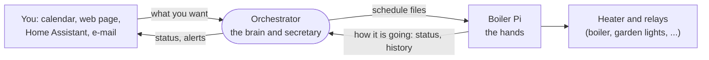
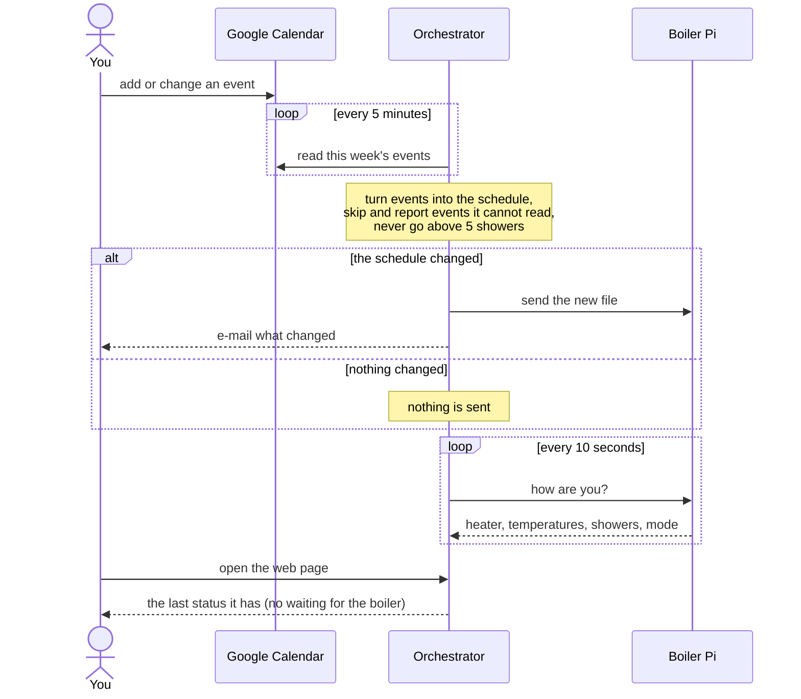
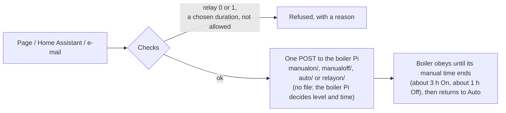
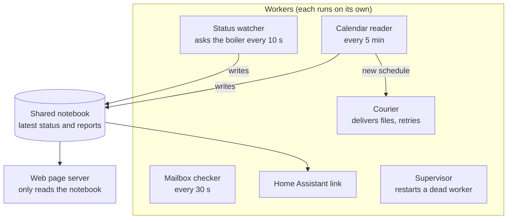

# Home Control Orchestrator

A small service for a Raspberry Pi 3. It replaces the old `BoilerControler.py` scripts and does four
things:

* builds the boiler schedule (`Cal.json`) and the timer schedule (`TimeCal.json`) from **Google
  Calendar** events (and from edits made on its **web page**) and sends them to the boiler Pi;
* shows the live boiler status and lets you switch the boiler **On / Off / Auto** and run relays;
* talks to **Home Assistant** over MQTT;
* accepts **e-mail commands** (with a two-step confirmation) and sends alerts to the admin.

The boiler Pi does the real work (heating, relays) from the files it is sent. It keeps working with
its last files whether the Orchestrator runs or not. The Orchestrator only uses the boiler Pi's HTTP
interface; it never touches files on that Pi. Pictures of the code and the flows are in
`docs/architecture.md`. `docs/Requirements.md` is the full specification,
`docs/traceability.md` maps every requirement to a test, `docs/PLAN.md` records how it was built.

## How it works, in plain words

**The idea in one sentence:** you write your hot-water plan in Google Calendar, the Orchestrator turns
it into files and hands them to the boiler Pi, and the boiler Pi heats the water to match.

There are two small computers (Raspberry Pis) in the house, and they have different jobs:

* The **boiler Pi** is the *hands*. It switches the heater and the relays on and off. It follows the
  files it was given and keeps doing so even if everything else is switched off.
* The **Orchestrator** (this program, on its own Pi) is the *brain and secretary*. It reads your
  calendar, writes the files, delivers them, checks that the boiler is doing what it should, and
  lets you give orders from a web page, Home Assistant or an e-mail.



### The pieces

| Piece | What it is, in human terms |
|---|---|
| **Google Calendar** | The schedule book. Each event is one line of the plan, for example `Boiler: target=3.5; min=2` (heat for 3.5 showers, never below 2) or `Timer: relaynum 4 start sunset +30 end 23:00` (garden lights from 30 minutes after sunset until 23:00). |
| **Schedule files** (`Cal.json`, `TimeCal.json`) | The plan written in the exact format the boiler Pi understands: one file for the boiler, one for the timers (relays). The boiler Pi reads them as plain text, so the Orchestrator writes them byte for byte as expected. |
| **Orchestrator** | Reads the calendar every 5 minutes, builds the files, sends them when they change, and asks the boiler Pi for its status every 10 seconds. |
| **Boiler Pi** | Does the heating and the relay switching. The Orchestrator never touches its disk; it only talks to its web interface (port 8000). |
| **Web page** (port 8080) | The control panel: live status, the 24 h chart, the schedules, the On / Off / Auto buttons and the relays. Works on a phone and a PC, on the home network only. |
| **Home Assistant** | Shows the boiler as entities and can send the same On / Off / Auto commands. Talks to the Orchestrator over MQTT. |
| **E-mail** | Send a short command from an allowed address (`status`, `on`, `off`, ...). Anything that changes something must be confirmed by replying to a one-time code. The admin also gets alerts here. |

### Words used on the page

* **Shower** is the unit for everything: how much hot water is in the tank, the **Target** (what the
  heater should heat up to) and the **Min** (the level to keep at all times in that period).
  The limit is **5 showers** everywhere, from every input.
* **Upper / Mid / Lower** are the three temperatures in the tank. The hottest one is Upper (hot water
  rises). The colours tell what the water is good for: blue below 30°, teal up to 40°, green 40-50°
  (good for a shower), amber 50-60°, red 60-70°, dark red above 70°.
* **Auto** follows the calendar. **Manual** is an order given by hand and lasts until the boiler Pi's manual time ends (about 3 hours for On, about an hour for Off), then the
  boiler goes back to Auto by itself. **Off** keeps the heater off.

### A normal day



### Giving a manual order

You press **On** on the page, send `on` from Home Assistant, or e-mail `on` (and confirm). All three go
through the same checks and end the same way:



### What happens when something goes wrong

The rule is: **never guess, never send half a plan.**

| Problem | What the Orchestrator does |
|---|---|
| Boiler Pi does not answer | The page shows "Boiler offline" and the controls are disabled. It keeps trying. The boiler keeps working from its last files. |
| A file could not be delivered | It keeps the file, retries with growing pauses, and tells the admin by e-mail after 15 minutes. |
| An event title cannot be understood | Only that event is skipped and listed as a problem on the page; the rest of the plan is still used. |
| The calendar cannot be read | The last good schedule stays in force; the page shows the reason. |
| Google login expired | The page and Home Assistant say "Google authorization needed"; the last schedule stays. |
| The Orchestrator itself stops | systemd restarts it. If it keeps failing, Home Assistant shows it as offline. |

### Inside the Orchestrator

Think of a small office where each worker has one job and they share one notebook:



The web page never waits for the boiler: it reads the notebook, so many open pages do not add load.
The page, Home Assistant and e-mail are three doors into the same room, so the same safety limits
apply whichever one you use.

If you only use the web page, [`docs/user-guide.md`](docs/user-guide.md) is the short guide for it.

For the code map, every flow in detail and the module list, see
[`docs/architecture.md`](docs/architecture.md). The rules and their numbers (FR-*, CS-*, OPS-*) are in
`docs/Requirements.md`.

## Safety rules the program follows

* The heater limit is **5 showers** on every channel (calendar, page, MQTT, e-mail, manual). A bigger
  value is refused, never reduced.
* An empty schedule is never sent. A failed push is retried; nothing is guessed.
* Manual On/Off/Auto are single POSTs to the boiler Pi (`manualon/`, `manualoff/`, `auto/`); the
  boiler Pi chooses the level and deletes its manual file when the time ends (about 3 hours for On,
  about an hour for Off). A chosen duration is refused. A relay command (`relayon/`, `relayoff/`)
  acts about 90 seconds after the request; a duration of 0 or less means on / off without a time
  limit.
* Relays 0 and 1 belong to the boiler service and can never be switched by hand (2 to 7 only).
* Nothing is sent to the boiler Pi until the clock of the Pi that runs the Orchestrator is synchronized.
* Passwords and tokens come from environment variables or files outside the program folder, and
  never appear in logs or answers.
* `DRY_RUN=1` builds and logs every file but sends nothing to the boiler Pi.

## Install on the Pi

The full step-by-step guide is in [`docs/INSTALL.md`](docs/INSTALL.md); this is the short version.

Needs Raspberry Pi OS (Trixie) with Python 3.11 or newer (3.13 is installed), network access to the
boiler Pi, and a router/NTP clock.

1. Copy this folder to the Pi (for example to `~/orchestrator-src`).
2. **Once**, check that every library installs on this Pi and write the version list that is deployed:
   `bash tools/check_pi_install.sh` (creates `requirements.lock` and `pi_install_report.txt`).
3. Install: `sudo bash deploy/install.sh`. It creates the user `orchestrator`, the folders
   `/opt/orchestrator`, `/etc/orchestrator`, `/var/lib/orchestrator`, `/var/log/orchestrator`, a virtual
   environment with the locked libraries, and the systemd unit. It also installs the starting
   configuration and the secrets template, and starts the service.
   Options: `--no-start`, and `--volatile-journal` (keep the system journal in memory to spare the
   SD card; the log files stay on disk).
4. Edit `/etc/orchestrator/config.toml` (boiler address, e-mail addresses, calendar) and
   `/etc/orchestrator/orchestrator.env` (secrets, root only, mode 600), then
   `sudo systemctl restart orchestrator`.
5. Authorize Google (below), set the boiler Pi's SSH host key (below), open `http://<pi>:8080/`.

**Update:** copy the new version over and run `sudo bash deploy/install.sh` again. The service is
stopped while the new program installs (a few minutes; the heating is not affected), the old program
is kept in `/opt/orchestrator/previous`, and if the new one does not start the old one is put back.
`sudo bash deploy/rollback.sh` swaps the two later. Configuration, secrets and data are never
overwritten.

## Configuration

All settings are in `config.toml`; `config.example.toml` lists every key with its default. The most
important ones:

| Section | Key | Meaning |
|---|---|---|
| `[general]` | `timezone`, `data_dir`, `log_dir`, `dry_run` | time zone, where files are kept |
| `[boiler]` | `base_url`, `poll_interval_s`, `ssh_host_key`, `reboot_grace_s` | the boiler Pi's address and reboot settings |
| `[limits]` | `max_showers` (`manual_margin` and `manual_duration_hours` are no longer used) | never above 5 showers |
| `[web]` | `host`, `port`, `login_required` | the web page (LAN only) |
| `[calendar]` | `calendar_id`, `poll_interval_s`, `write_back` | `write_back = true` lets the page change the real calendar |
| `[mail]` | `user_email_list`, `admin_email`, `security_alert_email`, `check_interval_s` | who may command, who is told |
| `[mqtt]` | `enabled`, `host`, `username`, `base_topic` | Home Assistant |
| `[location]` | `latitude`, `longitude` | needed for sunrise / sunset events |
| `[relays]` | `names` | relay names usable in calendar titles (`Timer: relaynum GardenLights ...`) |
| `[logging]` | `level`, `json_format`, `file_max_bytes` | log level and size of the log files (at most 20 MB together) |

### Environment variables (secrets)

Set in `/etc/orchestrator/orchestrator.env`. None of them is ever written to a log.

| Variable | Used for |
|---|---|
| `BOILER_SSH_USER`, `BOILER_SSH_KEY_FILE` or `BOILER_SSH_PASSWORD` | the `reset` e-mail command (reboot of the boiler Pi) |
| `MQTT_PASSWORD` | the MQTT broker login |
| `UI_PASSWORD` | the web page login (when `login_required = true`) |
| `GOOGLE_CLIENT_SECRET_FILE`, `GOOGLE_TOKEN_FILE`, `GOOGLE_CALENDAR_TOKEN_FILE` | Google access (files under `/var/lib/orchestrator/google/`); the last one is an optional second login used only for the calendar |
| `DRY_RUN` | `1` builds and logs files but sends nothing to the boiler Pi |
| `ORCHESTRATOR_CONFIG` | path of `config.toml` (set by the systemd unit) |

## Google authorization

The service reads the calendar and the command mailbox with an OAuth 2.0 login you do once.

**Using the logins of the old scripts (no new sign-in).** Put `client_secret.json` and the folder
`.credentials/` (with `Gmail-python-quickstart.json` and `Calendar-python-quickstart.json`) next to
this README, or anywhere and give the folder with `--google-from DIR`. `deploy/install.sh` then
converts them on the first install and puts the results in `/var/lib/orchestrator/google/`:

| Old file | New file | Used for |
|---|---|---|
| `client_secret.json` | `client_secret.json` | the sign-in tool only |
| `.credentials/Gmail-python-quickstart.json` | `token.json` | the command mailbox |
| `.credentials/Calendar-python-quickstart.json` | `calendar_token.json` | reading the calendar |

The two old logins have different permissions and cannot be merged, so the program keeps them as two
files and uses each for its own job. The old calendar login is **read-only**: schedules are read from
the calendar, but editing them in the page (`write_back`) stays off until you make a login with the
full calendar permission (`python -m orchestrator.auth`, below), which then replaces
`calendar_token.json`. Existing files are never overwritten; `--no-google-import` skips this step.
Check the result with `... -m orchestrator.auth --token /var/lib/orchestrator/google/token.json --check --for mail`
(and `--for calendar` for the other). The old files stay where they are: delete them from the source
folder once the service works, and never commit them (`.gitignore` already excludes them).

1. In the Google Cloud console create a project, enable the **Google Calendar API** and the **Gmail
   API**, create an OAuth client of type *Desktop app*, download `client_secret.json` and put it in
   `/var/lib/orchestrator/google/` (owner `orchestrator`, mode 600).
2. Set the consent screen to **"In production"**. In "Testing" mode Google expires the token after
   7 days. An unverified personal app only shows a warning at the consent step.
3. Run the tool as the service user (on the Pi with a desktop and browser):

   ```
   cd /opt/orchestrator/current
   sudo -u orchestrator venv/bin/python -m orchestrator.auth \
       --client-secret /var/lib/orchestrator/google/client_secret.json \
       --token /var/lib/orchestrator/google/token.json --port 8765
   ```

   The tool listens briefly on its own port (`--port`, here 8765) to receive Google's answer; do not
   use 8080, the web page's port, while the service runs. Without a browser on the Pi add
   `--no-browser` and, from your PC, `ssh -L 8765:localhost:8765 pi@<pi>`; open the printed address
   on the PC.
   The Pi may boot to the command line; start the desktop only for this step.
4. `... -m orchestrator.auth --token ... --check` tells whether the token works (`--offline` does not
   contact Google; `--for mail` or `--for calendar` checks it for one job). An old token can be
   converted by hand with `--import-oauth2client FILE --for mail|calendar`.

When Google refuses the login the page shows **Google authorization needed**, Home Assistant shows
it, and the admin is mailed if mail still works. The last schedules stay in force.

## Reboot of the boiler Pi over SSH

The `reset` e-mail command runs `sudo reboot` on the boiler Pi. It is refused until the Pi's host
key fingerprint is in `[boiler] ssh_host_key`; credentials are never sent to an unrecognised host.

```
cd /opt/orchestrator/current
sudo -u orchestrator venv/bin/python -m orchestrator.ssh_reboot --show-host-key --config /etc/orchestrator/config.toml
```

Compare the result with `ssh-keygen -lf /etc/ssh/ssh_host_ed25519_key.pub` run on the boiler Pi, then
copy it into `config.toml`. The SSH user needs `sudo reboot` without a password.

## Using it

**Web page** (`http://<pi>:8080/`): status, 24 h chart, schedules, manual buttons, relays, system
tab. Schedule editing works only with `[calendar] write_back = true` and writes the changes to the
calendar as events (`Boiler: target=3.5; min=2`, `Timer: relaynum 4 start sunset +30 end 23:00`).
With `login_required = true` a password is needed for actions, not for reading.

**E-mail** (from an address in `user_email_list`, first word of the subject):
`status`, `log`, `on`, `off`, `auto`, `switch <relay 2-7> <seconds>`, `reset`. Everything except
`status` and `log` is answered with a mail whose subject is a 10-letter token; reply to it within 2
minutes (the token works once, from the same address) to run the command. Five wrong tokens lock
e-mail commands for 15 minutes. Mail from other addresses is deleted, not answered, and reported
to `security_alert_email`.

**Home Assistant:** with `[mqtt] enabled = true` the entities appear by themselves (discovery).
Commands: topic `<base>/cmd/manual` (`on`, `off`, `auto`; a chosen `hours` is refused) and
`<base>/cmd/relay/<n>` (`ON`, `OFF`, or `{"state":"ON","seconds":300}`). Home Assistant shows the
Orchestrator as **offline** when it dies: add a notification for that.

## Running and monitoring

```
systemctl status orchestrator          journalctl -u orchestrator -f
sudo systemctl restart orchestrator    curl http://localhost:8080/healthz
```

* `python -m tools.perf_check --duration 3600` (run on the Pi while the service runs) measures memory,
  CPU and response times for an hour and compares them with the budgets of NFR-1a (exit code 1 if one
  is exceeded).
* `/healthz` needs no login: HTTP 200 when everything is `ok` or `degraded` (for example the boiler
  Pi is offline), 503 when a component is `failed`. It lists each component, the version, uptime,
  memory, CPU temperature, free disk and clock state.
* systemd restarts the service on a crash and, through the watchdog, when it hangs. After 5 starts in
  10 minutes it stays failed; Home Assistant then shows it offline.
* Log files: `/var/log/orchestrator/orchestrator.log` (and `audit.log` for every action, with who and
  through which channel). One `heartbeat` line per hour carries the key figures.
* The admin gets one mail when a problem starts and one when it ends: boiler Pi down/back, calendar
  unreadable, calendar changed (with the difference), Google authorization lost, disk below 10 %,
  memory, CPU temperature, clock, a schedule file not delivered for 15 minutes.

## Troubleshooting

| What you see | Likely cause and what to do |
|---|---|
| Page chip **Boiler offline**, banner "Boiler not responding" | The boiler Pi or its network is down. Controls are disabled; its last files keep working. Check `[boiler] base_url` and `curl http://<boiler>:8000/status/`. |
| **Google authorization needed** | Token revoked, expired ("Testing" mode) or missing. Run the authorization step again. |
| A manual command says "not sent" | The boiler Pi did not accept the POST (offline, or an HTTP error shown in the answer). It is sent once, never retried; press the button again. Check `curl -X POST http://<boiler>:8000/auto/` only if you want to test the endpoint by hand. |
| Schedule files are not sent | The clock is not synchronized yet (`timedatectl`), or `DRY_RUN` is on. See the System tab and the log. Manual commands do not wait for the clock: the boiler Pi uses its own. |
| A relay stays on | It was switched on with a duration of 0 or less (no time limit). Press Off, or send OFF. |
| Nothing changes after editing in the page | Editing needs `write_back = true`; the change appears after the next calendar read (a few seconds). |
| `reset` mail answers "host key is not configured" | Set `[boiler] ssh_host_key` (above). |
| `reset` fails with "login was refused" | Check `BOILER_SSH_USER` and the key file or password; the user needs passwordless `sudo reboot`. |
| Sunrise/sunset events are skipped | Set `[location] latitude` and `longitude`. |
| Service keeps restarting | `journalctl -u orchestrator -n 100`; a configuration error stops it with a clear message. |
| Home Assistant entities are "unknown" | The boiler reading is missing or old (values are never guessed), or the broker is unreachable. |

## Development

```
py -3.13 -m venv .venv
.venv\Scripts\python -m pip install -r requirements-dev.txt
.venv\Scripts\python -m tools.check          # black, ruff, mypy, pytest
.venv\Scripts\python -m tools.ui_smoke       # the page in a headless Chrome, against fakes
.venv\Scripts\python -m tools.freeze_tested  # requirements.tested.txt
```

Tests never contact a real host: the boiler Pi, Google, the MQTT broker and SSH are all faked.
Do not run the service on a development machine against the real boiler Pi; use `DRY_RUN=1`.
The one version constant is `orchestrator.__version__`.
