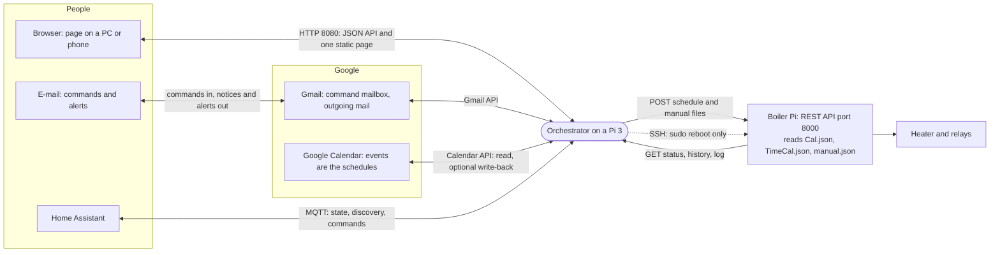
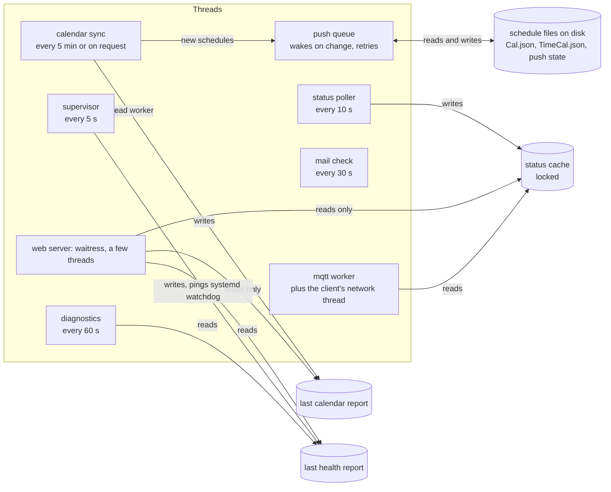
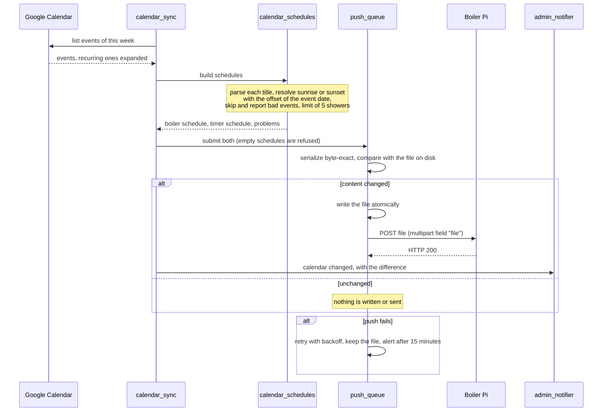
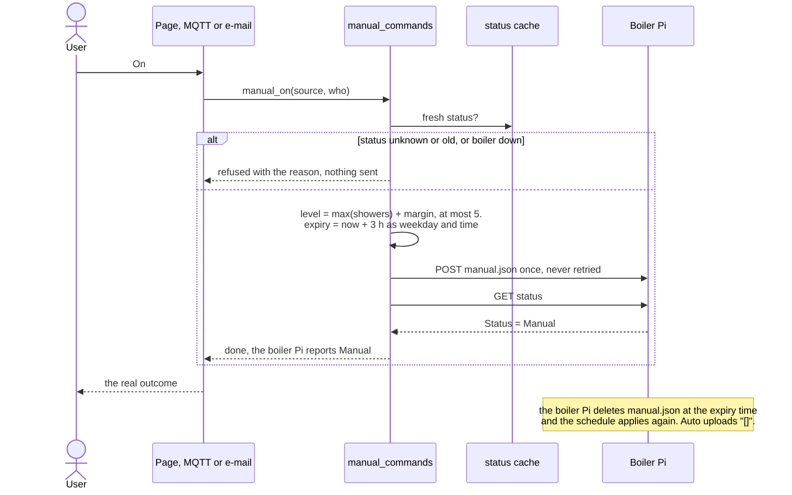
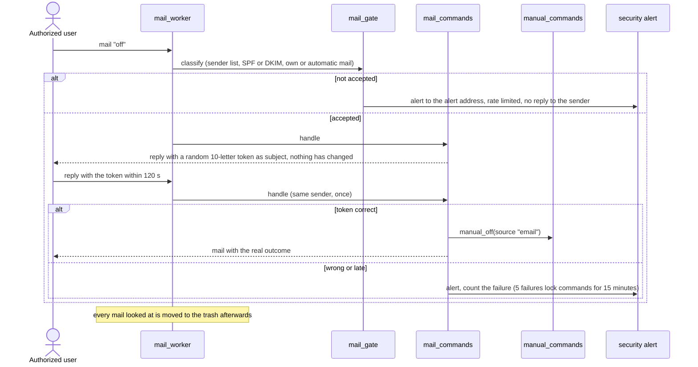
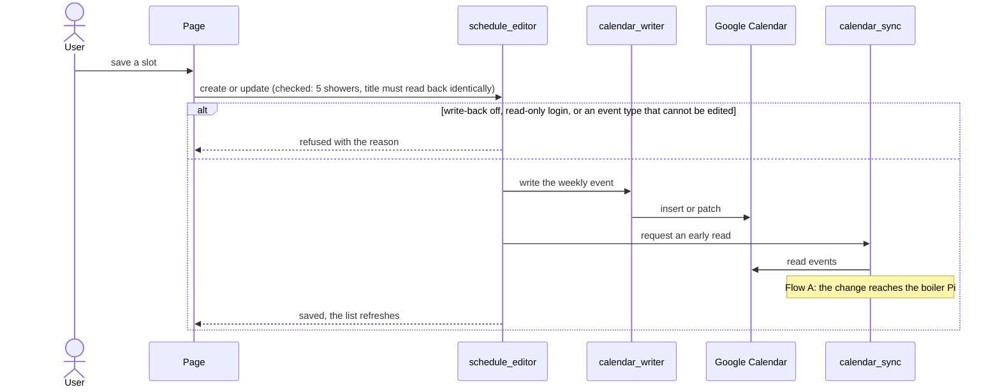
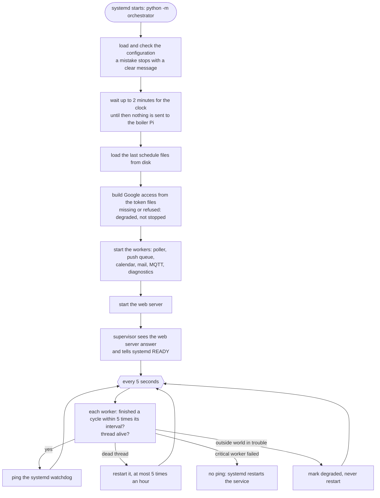

# Architecture: code and flow

Diagrams are in [Mermaid](https://mermaid.js.org/): they show as pictures on GitHub and in VS Code
(with a Mermaid preview extension). A test (`tests/test_docs.py`) checks that every module of the
`orchestrator` package is named here, so this page cannot silently go out of date.

## 1. The system around the Orchestrator

The boiler Pi keeps working from its last files whether the Orchestrator runs or not. The
Orchestrator only uses its REST interface (and SSH for the `reset` command).

## 2. Code map: modules by layer

```mermaid
flowchart TB
    subgraph entry["Start and wiring"]
        main["__main__ / app: builds everything, starts it in the order of OPS-2"]
        config["config: TOML plus secrets from the environment"]
        logging_setup["logging_setup: logs, redaction, audit, correlation ids"]
        clock["clock: time zone, injectable clock"]
    end

    subgraph core["Pure logic: no network, no threads"]
        models["models: slots, entries, status, history"]
        weekdays["weekdays: day 1 = Sunday, expiry time"]
        schedule_files["schedule_files: byte-exact writer and reader"]
        validation["validation: limit of 5 showers, rules"]
        manual["manual: manual.json and relay run files"]
        temperatures["temperatures: fixed sensor positions"]
        relays["relays: relay names"]
        event_titles["event_titles: grammar of calendar titles"]
        astro["astro: sunrise, sunset with the event date's offset"]
        files["files: atomic writes"]
    end

    subgraph boilerside["Boiler Pi side"]
        boiler_client["boiler_client: REST client, DRY_RUN"]
        status_cache["status_cache: poller and locked cache"]
        push_queue["push_queue: change detection, retry, gate"]
        manual_commands["manual_commands: On, Off, Auto, relay run"]
    end

    subgraph calendar["Calendar side"]
        calendar_source["calendar_source: reads events"]
        calendar_schedules["calendar_schedules: events to schedules"]
        calendar_sync["calendar_sync: the periodic read"]
        calendar_writer["calendar_writer: create, change, delete events"]
        schedule_editor["schedule_editor: edit rules, conflicts"]
        google_auth["google_auth and auth: tokens, sign-in tool"]
    end

    subgraph channels["Front ends over the same commands"]
        web_api["web_api, web_input, ui/index.html"]
        mqtt_bridge["mqtt_bridge: Home Assistant"]
        mail_client["mail_client: Gmail"]
        mail_gate["mail_gate: sender checks, alerts"]
        mail_commands["mail_commands: 2-step token flow"]
        mail_worker["mail_worker: inbox loop"]
        ssh_reboot["ssh_reboot and reboot_grace"]
    end

    subgraph ops["Operation"]
        supervisor["supervisor: health, watchdog, healthz"]
        system_facts["system_facts: memory, disk, temperature, clock"]
        diagnostics["diagnostics: resource alerts, heartbeat"]
        admin_notifier["admin_notifier: mails to the admin"]
    end

    main --> config
    main --> logging_setup
    main --> clock
    main --> boilerside
    main --> calendar
    main --> channels
    main --> ops

    calendar_source --> calendar_schedules
    event_titles --> calendar_schedules
    astro --> calendar_schedules
    calendar_schedules --> calendar_sync
    calendar_sync --> push_queue
    schedule_editor --> calendar_writer
    google_auth --> calendar_source
    google_auth --> mail_client

    push_queue --> schedule_files
    push_queue --> boiler_client
    status_cache --> boiler_client
    manual_commands --> manual
    manual_commands --> boiler_client
    manual_commands --> status_cache

    web_api --> manual_commands
    web_api --> schedule_editor
    web_api --> status_cache
    mqtt_bridge --> manual_commands
    mail_commands --> manual_commands
    mail_worker --> mail_gate
    mail_worker --> mail_commands
    mail_commands --> ssh_reboot
    mail_gate --> mail_client
    mail_commands --> mail_client

    schedule_files --> models
    validation --> models
    manual --> models
    temperatures --> models
    models --> weekdays

    supervisor --> system_facts
    diagnostics --> admin_notifier
    admin_notifier --> mail_client
```

Rules that keep it simple:

* The **pure logic** layer imports nothing from the other layers.
* Every front end (page, MQTT, e-mail) calls the **same** `manual_commands` object, so the 5-shower
  limit, relays 2 to 7 only, and the audit log apply to all of them.
* Only `push_queue` and `manual_commands` send files to the boiler Pi, only through `boiler_client`.
* Nothing is done at import time and dependencies are passed in, so everything is tested with fakes.

## 3. What runs when the service is up

HTTP handlers only read the shared state, except actions (manual commands, schedule edits), which
call the command objects, and the 24 h history, which is fetched on demand and kept for a minute.

## 4. Flow A: a calendar event becomes a heating schedule

## 5. Flow B: manual On, Off, Auto (page, MQTT or e-mail)

## 6. Flow C: an e-mail command with two-step confirmation

## 7. Flow D: editing a schedule in the page

## 8. Flow E: start-up and supervision

`/healthz` answers from the last check: 200 for ok or degraded, 503 for failed.

## 9. Where to look

| I want to change... | Start in |
|---|---|
| the format of the files sent to the boiler Pi | `schedule_files`, then `models` |
| what a calendar title means | `event_titles`, `calendar_schedules` |
| manual On/Off rules or the 5-shower limit | `manual`, `validation`, `manual_commands` |
| the web page | `ui/index.html` (one file), `web_api`, `web_input` |
| who may send e-mail commands | `mail_gate`, `mail_commands` |
| Home Assistant entities | `mqtt_bridge` |
| alerts and health | `admin_notifier`, `diagnostics`, `supervisor` |
| how it is installed | `deploy/`, `docs/INSTALL.md` |
